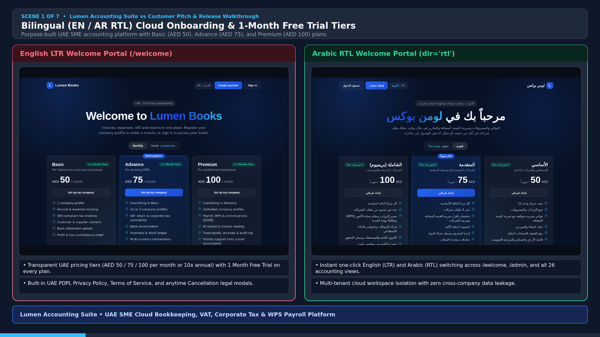
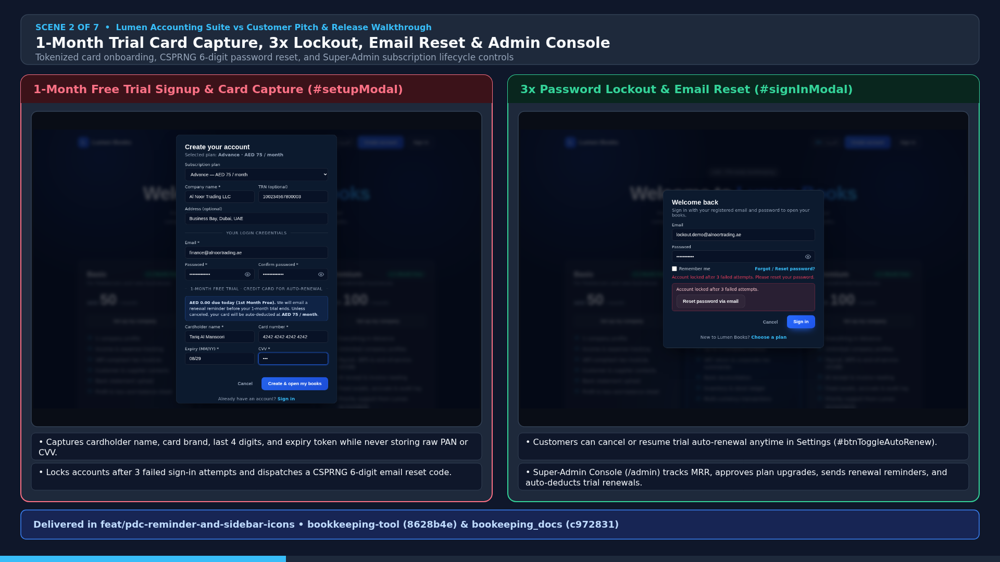
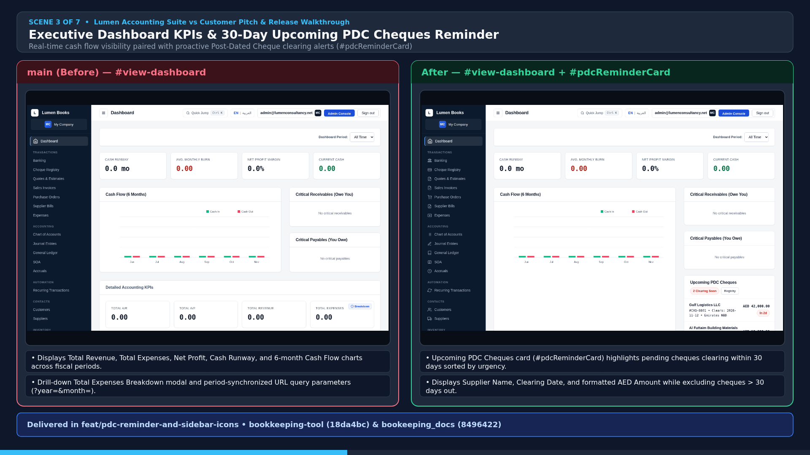
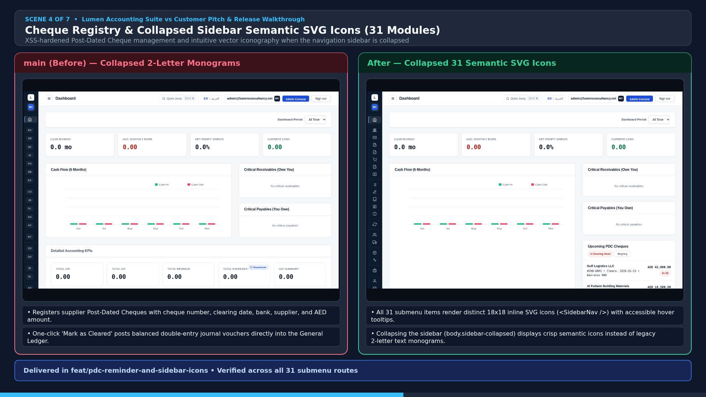
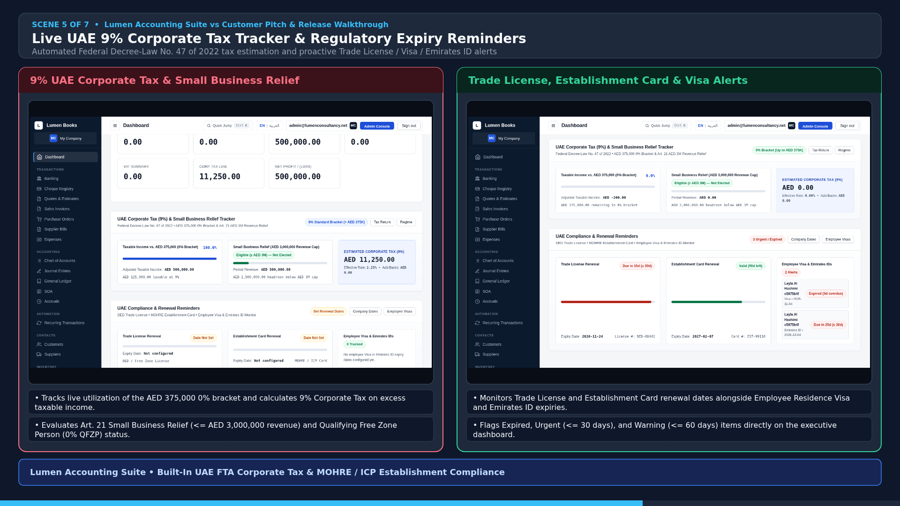
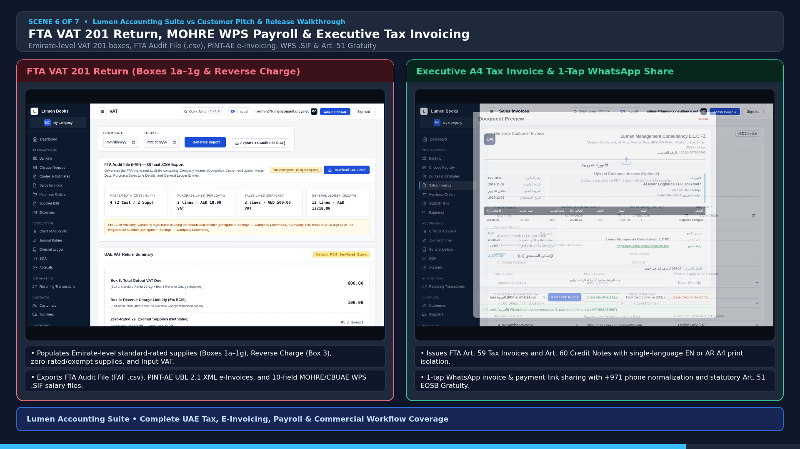
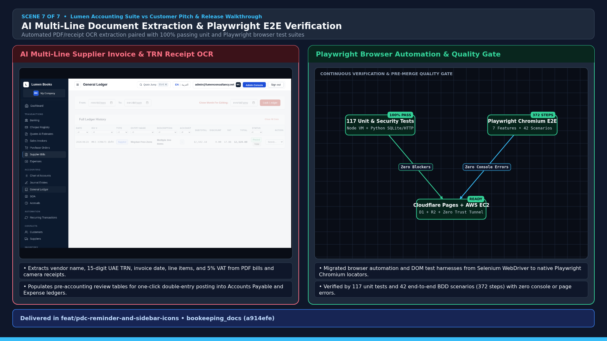

# Lumen Accounting Suite — Customer Pitch Deck & Visual Walkthrough

This directory contains the `1920x1080` customer pitch slide deck (`slide_01_*.png` – `slide_07_*.png`), the MP4 video walkthrough ([`lumen_accounting_suite_pitch_and_walkthrough.mp4`](lumen_accounting_suite_pitch_and_walkthrough.mp4)), and the declarative slide specification ([`slides.json`](slides.json)) used to present the **Lumen Accounting Suite** to prospective UAE SME customers and partners.

---

## 1. Pitch Video (`1920x1080` MP4)

- **Video File**: [`docs/presentations/lumen_accounting_suite_pitch_and_walkthrough.mp4`](lumen_accounting_suite_pitch_and_walkthrough.mp4) (`H.264 / yuv420p`, `1920x1080`, 7 scenes)
- **Declarative Slide Spec**: [`docs/presentations/slides.json`](slides.json)
- **Source UI Screenshots**: [`docs/presentations/screenshots/`](screenshots/)

<video src="lumen_accounting_suite_pitch_and_walkthrough.mp4" controls width="100%"></video>

---

## 2. Presentation Slides (`1920x1080`)

### Slide 1 — Bilingual (EN / AR RTL) Cloud Onboarding & 1-Month Free Trial Tiers

- **Key Customer Value**: Purpose-built UAE SME cloud accounting suite with transparent monthly/annual pricing (**Basic AED 50**, **Advance AED 75**, **Premium AED 100**), **1 Month Free Trial** across all plans, built-in UAE PDPL legal compliance modals, and instant one-click switching between **English (LTR)** and **Arabic (RTL)** across all 26 modules.

---

### Slide 2 — 1-Month Trial Card Capture, 3x Password Lockout, Email Reset & Super-Admin Console

- **Key Customer Value**: Frictionless 1-month free trial onboarding with PCI-safe card tokenization (storing only card brand, last 4 digits, expiry, and token), self-service **Cancel / Resume Auto-Renewal** in Settings (`#btnToggleAutoRenew`), 120,000-iteration PBKDF2-SHA256 authentication with **3-attempt password lockout**, CSPRNG **6-digit email password reset**, online-only cloud state (`Cache-Control: no-store`, zero local browser IndexedDB attachment residue), and a full **Super-Admin Console (`/admin`)** for MRR tracking, upgrade approvals, trial renewal reminders, and automated renewal deductions.

---

### Slide 3 — Executive Dashboard KPIs & 30-Day Upcoming PDC Cheques Reminder

- **Key Customer Value**: Real-time executive visibility into Total Revenue, Total Expenses, Net Profit, Cash Runway, and 6-month Cash Flow trends, paired with the **Upcoming PDC Cheques (`#pdcReminderCard`)** widget that proactively alerts finance teams on pending Post-Dated Cheques clearing within **30 days** (displaying Supplier Name, Clearing Date, and AED Amount sorted by urgency).

---

### Slide 4 — Post-Dated Cheque Registry & Collapsed Sidebar Semantic SVG Icons (31 Modules)

- **Key Customer Value**: Dedicated **Post-Dated Cheque Registry (`#view-cheques`)** with one-click General Ledger clearing and full HTML XSS protection, paired with a collapsible navigation sidebar (`body.sidebar-collapsed`) that renders distinct **18x18 semantic SVG icons (`<SidebarNav />` in `views-dashboard.js`)** and hover tooltips across all **31 submenu modules** instead of abbreviated text monograms.

---

### Slide 5 — Live UAE 9% Corporate Tax Tracker & Regulatory Expiry Reminders

- **Key Customer Value**: Automated **UAE Federal Decree-Law No. 47 of 2022 Corporate Tax Tracker (`#corpTaxTrackerCard`)** monitoring the **AED 375,000 0% bracket**, **9% standard bracket**, **Art. 21 Small Business Relief (AED 3M threshold)**, and **Qualifying Free Zone Person (0% QFZP)** eligibility, alongside the **UAE Compliance Reminder (`#uaeComplianceReminderCard`)** tracking **Trade License**, **Establishment Card**, **Employee Residence Visa**, and **Emirates ID** renewal dates.

---

### Slide 6 — FTA VAT 201 Return, MOHRE WPS Payroll & Executive Bilingual Tax Invoicing

- **Key Customer Value**: Emirate-level **FTA VAT 201 Return** (`Boxes 1a–1g`, `Box 3` Reverse Charge, Input VAT recovery), **FTA Audit File (`.csv`)**, **PINT-AE UBL 2.1 e-Invoicing**, **10-field MOHRE/CBUAE WPS `.SIF` salary files**, **Art. 51 End-of-Service Gratuity calculator**, and **FTA Art. 59 Tax Invoices / Art. 60 Credit Notes** with single-language EN/AR A4 print isolation and **1-tap WhatsApp payment link sharing**.

---

### Slide 7 — AI Multi-Line Document Extraction & Playwright Browser Verification

- **Key Customer Value**: Built-in **AI Document Extraction (`agy_service.py`)** for multi-line PDF Supplier Tax Invoices, Customer Invoices, Petty Cash Receipts, Bank Statements, and 15-Digit UAE Vendor TRN Camera Receipts, backed by **117 automated unit & security tests** and **42 Playwright Chromium BDD end-to-end scenarios (372 steps)**.

---

## 3. Maintaining & Regenerating the Pitch Deck and Video

Whenever new customer-facing features are added or UI workflows are updated:
1. Capture updated verification screenshots into [`docs/presentations/screenshots/`](screenshots/).
2. Update [`docs/presentations/slides.json`](slides.json) with any new scenes or bullet points.
3. Re-render the `1920x1080` PNG slides and MP4 video:
   ```bash
   python3 /root/.gemini/antigravity-cli/skills/.agents_review-branch/scripts/render_branch_comparison_video.py \
     --spec docs/presentations/slides.json \
     --out docs/presentations/lumen_accounting_suite_pitch_and_walkthrough.mp4
   ```
