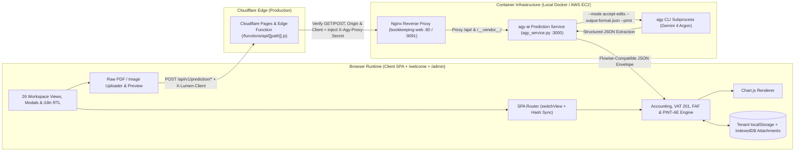
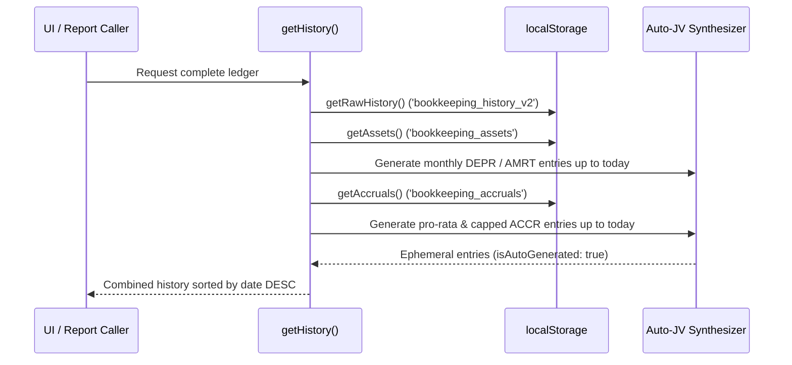

# Technical Architecture & Execution Flow

## 1. High-Level Architecture

Lumen Accounting Suite is a browser-hosted multi-module Single-Page Application (SPA) and multi-tenant commercial workspace built with vanilla HTML5, CSS3, and ES6+ JavaScript across 3 HTML entrypoints (`index.html`, `welcome.html`, `admin.html`), `script.js`, and 20 specialized domain modules (`profiles-storage.js`, `profiles-ui.js`, `auth.js`, `welcome-plans.js`, `welcome.js`, `admin.js`, `plan-access.js`, `plan-gating.js`, `i18n.js`, `attachments-store.js`, `ar-posting-fix.js`, `fx-correction.js`, `po-preview.js`, `po-receiving.js`, `quote-preview.js`, `einvoice-ae.js`, `credit-notes.js`, `vat201.js`, `faf-export.js`, `expenses.js`). Locally, it is served via an Nginx reverse proxy (`bookkeeping-web` on port `9091`) configured in `default.conf` with clean URL routes (`/welcome`, `/admin`), `/__vendor__/` offline asset shims (`pdf.min.js`), and `/api/` reverse-proxy forwarding (`client_max_body_size 50M`, `proxy_read_timeout 300s`) to the containerized `agy-ai` prediction service (`bookkeeping-agy-ai` on port `3000`, running `agy_service.py`). In production, the static suite and its edge proxy (`functions/api/[[path]].js`) are deployed on **Cloudflare Pages** (`https://lumen-bookkeeping.pages.dev` and `https://bookeeping.lumenconsultancy.net`), which enforces HTTP method allowlisting (`GET`/`POST`), validates the request `Origin` and `X-Lumen-Client: lumen-bookkeeping-web` header at the Cloudflare edge, fails closed (`503`) if `AGY_BACKEND_URL` is absent, injects the shared secret `X-Agy-Proxy-Secret`, and forwards `/api/v1/prediction/*` requests to the **AWS EC2** `agy-ai` stack (`i-09003c32e39617fea` in `us-east-1`, `docker-compose.prod.yml`). Transactional, master-data, and configuration state is persisted synchronously in tenant-scoped browser `localStorage` (`LumenProfiles`), while binary document attachments (`fileBase64`) are offloaded asynchronously to **IndexedDB** (`attachments-store.js` / `lumen_attachments_v1`). At read time, the ledger engine dynamically merges persisted transactions (`bookkeeping_history_v2`) with deterministically synthesized depreciation, amortization, and deferred-revenue recognition journal vouchers derived from active Fixed Assets and Accrual/Deferred Revenue schedules.



---

## 2. Phase-by-Phase Technical Breakdown

### Phase 1: Multi-Tenant Auth, Chart of Accounts Initialization & SPA Routing

When the browser loads `welcome.html`, `admin.html`, or `index.html`, the suite initializes multi-tenant storage isolation (`profiles-storage.js`), PBKDF2-SHA256 authentication (`auth.js`), bilingual `EN`/`AR` RTL dictionary translation (`i18n.js`), subscription plan gating (`plan-access.js`, `plan-gating.js`), and the 26-view workspace router:

1. **Multi-Tenant Storage Isolation & RBAC (`profiles-storage.js`, `auth.js`, `plan-access.js`, `plan-gating.js`)**:
   - `profiles-storage.js` wraps `Storage.prototype.getItem`, `setItem`, and `removeItem` so all non-global `bookkeeping_*` keys are transparently prefixed with `profile:<activeProfileId>::<key>`.
   - Unauthenticated sessions resolve to the `'unauthenticated'` storage namespace and are redirected from `index.html` to `/welcome`. Non-owner accounts (`id !== 'owner'`) only see their own company profiles (`tenant-${accId}` fallback) and cannot invoke owner-only administrative APIs (`setPlan`, `listAllAccounts`, `updateAccountAdmin`, `approvePlanRequest`, `impersonateAccount`).
   - `plan-access.js` and `plan-gating.js` map canonical subscription tiers (`basic`, `advance`, `premium`, plus legacy aliases `free`/`trial` $\rightarrow$ `basic`, `pro` $\rightarrow$ `advance`, `enterprise` $\rightarrow$ `premium`) to screen locks and company-profile limits (`{ basic: 1, advance: 3, premium: Infinity }`).

2. **Chart of Accounts (COA) Initialization**:
   - A default `CHART_OF_ACCOUNTS` array of 37 standard accounts across 5 types (`Asset`, `Liability`, `Equity`, `Revenue`, `Expense`) is defined in memory (`1000 Cash` through `7000 Depreciation Expense`, including `2150 Deferred Revenue` for IFRS 15 unearned customer advances).
   - **Persistence Override & Fallback Branching**:
     - If `localStorage.getItem('bookkeeping_coa')` exists, `CHART_OF_ACCOUNTS` is replaced completely by the parsed JSON array (with `script.js` ensuring `2150 Deferred Revenue` is present).
     - Otherwise, if `localStorage.getItem('bookkeeping_custom_accounts')` contains entries, those custom accounts are concatenated onto the default array.
   - **Expense Account Predicate (`window.isExpenseAccount`)**:
     - Returns `false` immediately if `accString` is falsy.
     - Otherwise lowercases `accString` and iterates through `CHART_OF_ACCOUNTS`. If `accLower` includes the account's `code`, equals `acc.name.toLowerCase()`, or includes `acc.name.toLowerCase()`, it returns `acc.type === 'Expense'`.
   - **Datalist Population**:
     - `#allCoaList` is populated with `<option value="${acc.code} ${acc.name}">` for every account.
     - `#supplierCoaList` is filtered to accounts where `acc.type === 'Expense'` or `acc.code` is in `['1300', '1400', '1410', '1420', '1600']` (Inventory, Prepaid Expenses, and Property, Plant & Equipment).

3. **SPA View Router (`switchView(targetId, title)`) & URL Hash Synchronization**:
   - Validates that `#${targetId}` is a valid `.app-view` element and checks `window.LumenPlanGate.canOpen(targetId)` so locked subscription views cannot be bypassed via URL hash or direct `switchView` calls.
   - Hides all `.app-view` elements (`style.display = 'none'`), displays `#${targetId}` (`style.display = 'block'`), updates `.nav-item.active` state, strips `'🔒'` from `#pageTitle.textContent`, and updates `window.history.replaceState(null, '', '#' + targetId)` (with inbound `hashchange` and initial `#view-*` load support).
   - Triggers view-specific rendering hooks based on `targetId` across all 26 views, including `view-audit` (`renderAuditLog()`), `view-equity-statement` (`renderEquityStatement()`), `view-accrual` (`loadAccrualsDirectory()`), `view-quotes` (`renderQuotesHistory()`), `view-po` (`renderPOHistory()`), and `view-recurring` (`renderRecurringTemplates()`).

3. **Startup Migrations & Background Timers**:
   - `loadCompanySettings()` populates currency rates, dropdowns, and saved settings from `bookkeeping_settings`.
   - `rebuildInventoryFromHistory()` executes once if `localStorage.getItem('inventory_rebuilt_v2')` is not set: it preserves `'Initial Stock'` movements from `bookkeeping_stock_ledger`, scans legacy `bookkeeping_history` for posted supplier inventory items (`1300`) and customer product sales, reconstructs `bookkeeping_stock_ledger` and `bookkeeping_inventory`, and sets `inventory_rebuilt_v2 = '1'`.
   - `updateKPIs()`, `loadCustomerDirectory()`, and `loadSupplierDirectory()` run synchronously on startup.
   - At `t + 500ms`, Quote and Purchase Order line items and history tables initialize.
   - At `t + 1000ms`, `renderRecurringTemplates()` and `executeRecurringTransactions()` run to auto-post any recurring templates whose `nextRunDate <= today`.

---

### Phase 2: State Persistence, Audit Trail & Dynamic Auto-JV Synthesis



1. **Raw vs. Synthesized Ledger State (`getRawHistory`, `getHistory`, `updateHistory`)**:
   - `getRawHistory()` reads persisted entries from `bookkeeping_history_v2`.
   - `getHistory()` begins with `getRawHistory()` and dynamically appends ephemeral journal entries (`isAutoGenerated: true`) for:
     - **Fixed Assets & Prepaid Assets (`bookkeeping_assets`)**:
       - Skips any asset missing `purchaseDate`, `initialValue`, or `years`.
       - Computes `maxMonths = parseInt(asset.years) * 12` and `monthlyDepreciation = parseFloat(asset.initialValue) / maxMonths`.
       - Starting from the last day of the purchase month (`new Date(purchaseDate.getFullYear(), purchaseDate.getMonth() + 1, 0)`), loops while `currentMonth <= today && monthsPassed < maxMonths`.
       - **Account Mapping Branches (`resolvePrepaidExpenseAccount`)**:
         - Default fixed asset: Debit `7000 Depreciation Expense`, Credit `1650 Accumulated Depreciation`, prefix `DEPR`.
         - Prepaid Expense Routing (`resolvePrepaidExpenseAccount(accountStr, itemCategory, itemsList)`):
           - If `itemCategory` or any item in `itemsList` has `category === 'COGS'`, or if `accountStr` matches `5000` / `cogs` / `cost of goods`, routes the amortization debit to `5000 Cost of Goods Sold` (`#accrualDrAcc = '5000 Cost of Goods Sold'`).
           - If `asset.account` matches `1410` or `prepaid rent`: Debit `6400 Rent Expense`, Credit `1410 Prepaid Rent`, prefix `AMRT`.
           - If `asset.account` matches `1420` or `prepaid software`: Debit `6200 Software & SaaS`, Credit `1420 Prepaid Software & SaaS`, prefix `AMRT`.
           - If `asset.account` matches `1400` or `prepaid`: Debit `6000 Office Supplies`, Credit `1400 Prepaid Expenses`, prefix `AMRT`.
     - **Accruals, Prepayments & Deferred Revenue (`bookkeeping_accruals`)**:
       - Supports both **straight-line monthly schedules** (`scheduleMode !== 'usage'`) and **usage/milestone-based schedules** (`scheduleMode === 'usage'` or `Array.isArray(accrual.usageEntries) && accrual.usageEntries.length > 0`, e.g., `2150 Deferred Revenue` customer advances and prepaid supplier credits routed to `5000 Cost of Goods Sold` or `6xxx` OpEx).
       - For usage-based schedules, iterates over `accrual.usageEntries` (`[{ id, date, amount, note }]`), caps each drawdown to `totalAmount - usedSoFar`, and emits a synthesized `journal` entry with ID `u.id || usage_${accrual.id}_${idx + 1}` and entity name `USE-${accrual.id.substring(0, 4).toUpperCase()}-${idx + 1}`.
       - For straight-line schedules, loops month-by-month from the end of `startDate`'s month while `currentMonth <= today && accumulated < totalAmount - 0.001`.
       - **First-Month Pro-Rata Calculation (`monthIndex === 0`)**:
         $$\text{daysActive} = \text{totalDaysInMonth} - \text{startDate.getDate()} + 1$$
         If $\text{daysActive} < \text{totalDaysInMonth}$, then:
         $$\text{jvAmount} = \text{monthlyAmt} \times \frac{\text{daysActive}}{\text{totalDaysInMonth}}$$
       - **Cap Enforcement**: If `accumulated + jvAmount > totalAmount`, `jvAmount` is capped to `totalAmount - accumulated`.
       - Emits an auto-generated `journal` entry with ID `accr_${accrual.id}_${year}_${month}` and entity name `ACCR-${id.slice(0,4)}-${monthIndex+1}`.
   - Finally, `getHistory()` sorts all entries in descending chronological order (`new Date(b.date) - new Date(a.date)`).
   - When `updateHistory(history)` is called to persist changes (e.g., status updates, edits, deletions), it filters out all synthesized entries (`history.filter(h => !h.isAutoGenerated)`) and offloads any inline `fileBase64` payloads into IndexedDB via `window.LumenAttachments` (`attachments-store.js`) before writing back to `bookkeeping_history_v2`.

2. **Period Locking (`isLocked(dateStr)`)**:
   - Reads `closedDateStr` from `localStorage.getItem('bookkeeping_closed_date')`.
   - Returns `true` if `closedDateStr` and `dateStr` are both non-empty and `new Date(dateStr) <= new Date(closedDateStr)`.
   - Locked entries display a `🔒` icon in the General Ledger, disallow deletion (`deleteEntry`), disallow customer invoice creation (`customerInvoiceForm`), disallow manual journal posting (`journalForm`), and preserve locked records when `clearHistoryBtn` ("Clear All Data") is triggered.

3. **Audit Logging (`logAuditEvent(action, module, details)`)**:
   - Prepends an event object `{ id, timestamp, user: 'Admin User', action, module, details }` to `bookkeeping_audit_log` and immediately re-renders `#auditLogBody` if `#view-audit` is currently visible.

---

### Phase 3: AI Document Processing Pipeline

1. **Raw PDF & Image Upload + Client Preview (`fileToDataURL(file)` & `convertPdfToImage(file)`)**:
   - When uploading a PDF or image across any of the 5 AI extraction workflows, the raw binary file is encoded as a Base64 Data URL (`application/pdf` or `image/*`) via `fileToDataURL(file)` and sent directly in the `uploads` array so `agy-ai` receives the lossless original PDF document.
   - For browser-side visual preview (`#pdfPreviewCanvas` / modal inspection), `convertPdfToImage(file)` loads the PDF `ArrayBuffer` via `pdfjsLib.getDocument({ data: arrayBuffer }).promise`, renders each page onto an HTML5 `<canvas>` at `scale: 2.0`, and stitches pages vertically.

2. **Resilient JSON Extraction (`extractJSON` / `custExtractJSON`) & Foreign Currency Repair (`fx-correction.js`)**:
   - Attempts to match a fenced block ```` ```json\n([\s\S]*?)\n``` ```` (or array boundaries `[` ... `]` for Petty Cash), falling back to slicing from the first `{` to the last `}`.
   - `fx-correction.js` (`LumenFxCorrection`) detects when an AI-extracted invoice or historical ledger entry was recorded in a foreign currency (`USD`, `EUR`, `GBP`, `SAR`, etc.) without AED conversion and normalizes `subtotal`, `discount`, `tax`, `total`, and line item amounts into AED using the configured exchange rate while preserving `originalCurrency`, `originalTotal`, and `exchangeRate`.

3. **Five AI Extraction Workflows (`script.js` & `expenses.js` $\rightarrow$ Cloudflare Pages Function / `bookkeeping-web` Nginx $\rightarrow$ `agy_service.py` $\rightarrow$ `agy` CLI)**:
   - **Multi-Layer Prediction Endpoint Security (`_verify_prediction_request_security`)**:
     - Before parsing any request body, `functions/api/[[path]].js` and `agy_service.py` enforce three security gates on `/api/*`:
       1. **Shared Proxy Secret (`X-Agy-Proxy-Secret`)**: When `AGY_API_SECRET` is configured (production AWS EC2), `agy_service.py` compares `X-Agy-Proxy-Secret` against `AGY_API_SECRET` via `hmac.compare_digest`. Missing or mismatched secrets raise `UnauthorizedPredictionRequestError` (`HTTP 401`, `code: "unauthorized"`).
       2. **Application Client Handshake (`X-Lumen-Client`)**: Verifies `X-Lumen-Client == "lumen-bookkeeping-web"`, sent by all 5 `fetch(aiEndpoint, ...)` call sites (`#processBtn`, `#custProcessBtn`, `#btnProcessJournalFile`, `#processBankBtn` in `script.js`, and `#expAnalyzeBtn` in `expenses.js`). Missing or invalid headers raise `UnauthorizedPredictionRequestError` (`HTTP 401`, `code: "unauthorized"`).
       3. **Origin & Referer Allowlist (`_is_allowed_origin`)**: Validates `Origin` (or `Referer` fallback) against trusted application origins (`https://lumen-bookkeeping.pages.dev`, `https://*.lumen-bookkeeping.pages.dev`, `https://bookeeping.lumenconsultancy.net`, `https://bookkeeping.lumenconsultancy.net`, `http://localhost:9091`, `http://127.0.0.1:9091`, `http://bookkeeping-web`). Untrusted origins raise `ForbiddenOriginPredictionError` (`HTTP 403`, `code: "forbidden_origin"`).
   - **Backend `agy` Prediction Execution (`agy_service.py`)**:
     - Validates `Content-Length` ($\le 50\text{ MB}$) and parses either `application/json` (`_parse_json_prediction_request`) or `multipart/form-data` (`_parse_multipart_form_data`).
     - Decodes each uploaded Base64 file into an isolated per-request directory `/tmp/agy_requests/req_<uuid>/<idx>_<sanitized_name>` (`_write_uploads_to_dir` with `is_relative_to` path-traversal protection).
     - Invokes `agy` non-interactively via `subprocess.run(..., cwd=str(req_dir))`:
       `agy --mode accept-edits --dangerously-skip-permissions --disable-slash-commands --output-format json --model "Gemini 4 Argon (High)" --print-timeout 99999h --add-dir <req_dir> --print <prompt>`
     - Extracts `response` and `conversation_id` from the JSON line output and returns `{"text": response, "conversation_id": conv_id, "status": status}` (or a sanitized structured error envelope `{"error": {"code": ..., "message": ...}, "text": "```json\n{}\n```"}` with HTTP `400`/`401`/`403`/`413`/`502`/`504`).
   - **Supplier Invoice (`#processBtn`)**:
     - Sends the raw PDF or image as Base64 JSON `{ question, uploads: [{ data, type: 'file', name, mime }] }` to `settings.flowiseEndpoint || '/api/v1/prediction/937be8b1-663e-45a5-a9d7-b5c912ac1abd'`.
     - Extracts header fields (`date`, `invoiceNum`, `entityName`, `trn`, `address`, `phone`, `subtotal`, `discount`, `tax`, `total`, `currency`) and line items (`description`, `qty`, `unitPrice`, `amount`, `tax`, `account`, `category` $\in \{\text{OpEx}, \text{COGS}, \text{Capitalized R\&D}\}$).
     - Performs duplicate detection against `getHistory()` before saving (`#duplicateInvoiceModal`), converts foreign currencies to AED, registers fixed assets/accruals/deferred revenue, logs stock `IN` movements if `1300 Inventory` is used, and saves the supplier bill to `bookkeeping_history_v2`.
   - **Customer Invoice (`#custProcessBtn`)**:
     - Extracts customer invoice fields and line items via `/api/v1/prediction/*`, auto-populates `#customerInvoiceForm`, sets VAT radio toggle (`standard` if `parsed.tax > 0`, else `zero`), and recalculates totals.
   - **Direct Expense Receipt (`#expAnalyzeBtn` in `expenses.js`)**:
     - Uploads a receipt PDF/image to `/api/v1/prediction/*`, populates merchant/payee, TRN, expense category account, net amount, VAT, payment method, paid-from account (`1000` Cash, `1005` Bank, `1010` Petty Cash, or `2000` Accounts Payable), and Corporate Tax Add-Back flag, and posts the expense as a `type: 'journal'`, `source: 'Expenses'` entry in `bookkeeping_history_v2`.
   - **Petty Cash Multi-Receipt Upload (`#btnProcessJournalFile`)**:
     - Accepts multiple PDF/image files in `#journalFileInput`, sends all files in the `uploads` array in a single request, renders an editable `#pettyCashReviewBody` table, and posts each receipt as a separate journal entry crediting `1010 Petty Cash Fund` when `#btnConfirmPettyCash` is clicked.
   - **Bank Statement Extraction & Rules Engine (`#processBankBtn`)**:
     - Sends the bank statement PDF/CSV/text to `/api/v1/prediction/*`, normalizes transaction signs, evaluates descriptions against `bookkeeping_bank_rules`, and matches payments to open invoices or posts bank journal entries (`#confirmSaveBankBtn`).

---

### Phase 4: Commercial, Credit Notes, Contacts & Inventory Subsystems

1. **Customer & Supplier Directories**:
   - `saveCustomer(cust, originalName)` and `saveSupplier(sup, originalName)` upsert contact records by name and refresh `#customerList`, `#supplierList`, and `#allEntitiesList` `<datalist>` elements.
   - **Referential Integrity**: `deleteCustomer(name)` checks `getHistory().some(h => h.type === 'customer' && h.entityName === name)` and blocks deletion with an alert if any invoice is linked to that customer.

2. **Tax Credit Notes (`credit-notes.js` — UAE FTA VAT Art. 60)**:
   - `window.LumenCreditNotes` (`credit-notes.js`) issues sequential Tax Credit Notes (`CRN-0001`, `CRN-0002`, ...) linked to an original Tax Invoice (`originalInvoiceId`, `originalInvoiceNum`).
   - Validates that the credit note total does not exceed the remaining creditable balance on the original invoice.
   - Persists an entry with `type: 'credit_note'`, `isCreditNote: true`, `status: 'posted'`, and reduces the linked invoice's outstanding receivable balance (`creditedAmount` / `amountPaid`).
   - In `getCalculatedBalances()`, `renderTrialBalance()`, `updateKPIs()`, `vat201.js`, and `faf-export.js`, credit notes reverse `4xxx` Revenue (`subtotal - discount`), reverse `2500 Output VAT` (`tax`), and credit `1200 Accounts Receivable` (`total`).

3. **Inventory Directory & Stock Ledger**:
   - **Bidirectional Pricing Math**:
     - Editing `#invCost` or `#invMarkup` computes $\text{Price} = \text{Cost} \times (1 + \frac{\text{Markup}}{100})$.
     - Editing `#invPrice` computes $\text{Markup} = \frac{\text{Price} - \text{Cost}}{\text{Cost}} \times 100$ (or `0` if $\text{Cost} \le 0$).
   - **Stock Movements (`window.logStockMovement`)**:
     - Appends a movement `{ id, date, productName, type: 'IN' | 'OUT', reference, qtyChange, unitCost, totalValue }` to `bookkeeping_stock_ledger` and adjusts `inv[existingIndex].qty += qtyChange` in `bookkeeping_inventory`.
   - **Automatic COGS & Stock Deduction on Customer Invoice**:
     - When a customer invoice is saved with a selected `productName` from inventory, the app logs an `'OUT'` stock movement (`-item.qty`) and posts a COGS journal entry (`5000 Cost of Goods Sold` Dr / `1300 Inventory` Cr for `item.qty * unitCost`).
   - **Stock Reversal on Invoice Deletion**:
     - Deleting a ledger entry (`deleteEntry(id)`) scans `bookkeeping_stock_ledger` for movements matching `entry.invoiceNum` or `Inv: ${entry.invoiceNum}`, reverses the `qtyChange` on `bookkeeping_inventory`, and removes the movement rows.

4. **Quotes, Purchase Orders & Recurring Templates (`quote-preview.js`, `po-preview.js`, `po-receiving.js`, `ar-posting-fix.js`)**:
   - **Quotes (`bookkeeping_quotes`)**: Created in `Draft` status with printable preview (`window.QuotePreview`); `convertQuoteToInvoice(id)` transitions status to `Invoiced` and prepends a normalized `type: 'customer'` sales invoice via `LumenPostingRepair.repairEntry()` (`ar-posting-fix.js`).
   - **Purchase Orders (`bookkeeping_pos`)**: Created in `Draft` status with printable preview (`window.POPreview`) $\rightarrow$ `receivePOGoods(id)` (`window.POReceiving`) records received quantities (`Goods Received`) $\rightarrow$ `convertPOToBill(id)` performs 3-way matching, transitions status to `Billed`, and prepends a normalized `type: 'supplier'` bill to `bookkeeping_history_v2`.
   - **Recurring Templates (`bookkeeping_recurring_v2`)**: `executeRecurringTransactions()` checks all templates where `nextRunDate <= today`, emits a `posted` Customer Invoice, Supplier Bill, or Journal Entry, and advances `nextRunDate` by 1 week, 1 month, or 1 year until `nextRunDate > today`.

---

### Phase 5: Payroll, Timesheets, UAE WPS & EOSB Engine

1. **Net Pay Formula (`calcNetPay(empId)`)**:
   $$\text{earnedPay} = \frac{\text{totalPay}}{30} \times \text{daysWorked}$$
   $$\text{netPay} = \text{earnedPay} + \text{bonus} - \text{loanDed} - \text{otherDed}$$

2. **Payroll Run & Multi-Journal Posting (`savePayroll()`)**:
   - Validates that `period` is selected, employees exist, and `totalNetPay > 0`.
   - Saves period snapshot to `localStorage.setItem('payroll_' + period, JSON.stringify({ employees, paymentAccount }))`.
   - Posts up to 5 double-entry journal vouchers dated `${period}-28`:
     1. **Gross Payroll**: Dr `6500 Payroll / Salaries`, Cr `2100 Accrued Liabilities` for `totalGross`.
     2. **Net Pay Disbursement**: Dr `2100 Accrued Liabilities`, Cr `paymentAccount` for `totalNetPay`.
     3. **Employee Loan Recovery** (if `totalLoanDed > 0`): Dr `2100 Accrued Liabilities`, Cr `1210 Employee Advances/Loans` for `totalLoanDed`.
     4. **Other Deductions** (if `totalOtherDed > 0`): Dr `2100 Accrued Liabilities`, Cr `6500 Payroll / Salaries` for `totalOtherDed`.
     5. **EOSB & Leave Accrual** (if `#payrollAccrueEOSB` is checked):
        - Monthly EOSB per employee: $\frac{\text{basicSalary}}{30} \times \frac{21}{12}$ (21 days basic pay per year of service under UAE Labour Law).
        - Monthly Leave Accrual per employee: $\frac{\text{totalFixed}}{12}$.
        - Posts Dr `6520 EOSB & Leave Expense`, Cr `2120 Provision for EOSB` for `totalEosb + totalLeave`.

3. **UAE WPS SIF Export (`generateWPS()`)**:
   - Generates an Employee Detail Record (`EDR`) row per employee and a trailing Salary Control Record (`SCR`) summary row, triggering a browser download of `WPS_${period}.sif`.

---

### Phase 6: Double-Entry Financial Reporting, KPIs, FP&A & UAE Tax Compliance

1. **Dashboard KPI Engine (`updateKPIs()`)**:
   - Supports filtering by Year (`#dashboardYearFilter`) and Month (`#dashboardMonthFilter`).
   - **P&L vs. Balance Sheet Date Scoping**:
     - `isPlItem(date)` matches only transactions within the selected year/month.
     - `isBsItem(date)` matches all cumulative transactions up to the end of the selected year/month.
   - **Net Revenue & Credit Note Deduction**:
     - Sums net revenue (`subtotal - discount`, excluding Output VAT) for posted/paid/partially paid customer invoices (`type === 'customer'` and not `2150 Deferred Revenue`), and subtracts net credit note amounts (`type === 'credit_note'`).
   - **Hero Metrics**:
     - $\text{Avg. Monthly Burn} = \frac{\text{Expenses in last 90 days}}{3}$
     - $\text{Cash Runway} = \text{Avg. Monthly Burn} > 0 \ ? \ \frac{\text{Current Cash}}{\text{Avg. Monthly Burn}} : 0$ (capped at `99+ mo` display)
     - $\text{Net Profit Margin} = \text{Total Revenue} > 0 \ ? \ \frac{\text{Net Profit}}{\text{Total Revenue}} \times 100 : 0$
   - **Actionable Hit Lists**: Populates `#criticalArList` and `#criticalApList` with the top 5 unpaid/partially paid customer and supplier invoices older than 30 days, sorted by age descending then balance descending.

2. **Trial Balance, Emirate-Level FTA VAT 201 (`vat201.js`), FTA Audit File (`faf-export.js`) & UAE Corporate Tax (`renderTrialBalance()`)**:
   - Aggregates debits and credits per 4-digit account code across all non-draft transactions within the selected date range (including customer invoices, tax credit notes, supplier bills, direct expenses, and manual/auto-generated journal entries).
   - **Emirate-Level FTA VAT 201 Return (`vat201.js`)**:
     - Classifies standard-rated (`5%`) supplies across Boxes `1a` (`Abu Dhabi`), `1b` (`Dubai`), `1c` (`Sharjah`), `1d` (`Ajman`), `1e` (`Umm Al Quwain`), `1f` (`Ras Al Khaimah`), and `1g` (`Fujairah`) based on `entry.placeOfSupply`, customer address, or company default Emirate, subtracting Tax Credit Notes (`type === 'credit_note'`) from the corresponding Emirate box.
     - Computes Box 2 (Tax Refunds for Tourists), Box 3 & Box 10 (Reverse Charge Supplies & Input), Box 4 (Zero-Rated Supplies), Box 5 (Exempt Supplies), Boxes 6–7 (Goods Imported into the UAE & Adjustments), Box 8 (Total Output VAT), Box 9 (Recoverable Standard-Rated Expenses), Box 11 (Total Recoverable Input VAT), and Boxes 12–14 (`netVat = outputVat - inputVat`, Payable or Refundable).
   - **FTA Audit File (FAF `.csv`) Export (`faf-export.js`)**:
     - Generates the 5-section UAE Federal Tax Authority Audit File (`CompInfo`, `Customer`, `PurcData`, `SuppData`, `GLData`) with balanced double-entry general ledger lines (`TotalDebit === TotalCredit`) and `TransactionCount`.
   - **UAE Corporate Tax Calculation**:
     - Computes $\text{Net Profit} = \sum (\text{Credits}_{4\text{xxx}} - \text{Debits}_{4\text{xxx}}) - \sum (\text{Debits}_{5\text{xxx}\text{--}7\text{xxx}} - \text{Credits}_{5\text{xxx}\text{--}7\text{xxx}})$.
     - Sums non-deductible add-backs (`ctAddBacks`) from supplier bills, direct expenses, and expense journal entries flagged with `isCtAddBack: true`.
     - $\text{Taxable Income} = \text{Net Profit} + \text{ctAddBacks}$.
     - If `companyType !== 'Qualifying Free Zone'` and `!smallBusinessRelief` and $\text{Taxable Income} > 375,000$:
       $$\text{Corporate Tax Payable} = (\text{Taxable Income} - 375,000) \times 0.09$$
       Otherwise $\text{Corporate Tax Payable} = 0.00$.

3. **Financial Statements & FP&A**:
   - `renderIncomeStatement()`, `renderBalanceSheet()`, `renderCashflow()` (including working-capital movements on `1200` AR, `1300` Inventory, `14xx` Prepaids, `1500`/`2500` VAT, `2000` AP, `2100` Accruals, `2150` Deferred Revenue, and `1650` Accumulated Depreciation), and `renderEquityStatement()` compute account balances via `getCalculatedBalances(fromD, toD)` and render structured financial statements.
   - `renderBudgeting()` compares monthly budgets (`bookkeeping_budgets[YYYY-MM][accountCode]`) against actuals for Revenue (`4xxx`) and Expense (`5xxx–7xxx`) accounts, labeling Revenue accounts `Target Met` ($\text{Actual} \ge \text{Budget}$) or `Under Target`, and Expense accounts `Under Budget` ($\text{Actual} \le \text{Budget}$) or `Over Budget`.
   - `renderCashflowForecast()` computes current cash across `1000`, `1005`, and `1010` and projects running cash balance across future customer invoice inflows and supplier bill outflows sorted by `dueDate || date`.

---

## 3. Payload & State Schemas

### 3.1 `localStorage` Keys & Runtime Schemas

#### `bookkeeping_history_v2` (Ledger Entries Array)
```json
[
  {
    "id": "1730538000000abc12",
    "date": "2026-11-02",
    "dueDate": "2026-11-17",
    "type": "customer",
    "status": "posted",
    "invoiceNum": "INV-1001",
    "entityName": "Acme Corp LLC",
    "description": "Consulting Services",
    "account": "4100 Service Revenue",
    "bankAccount": "1005",
    "paymentTerms": "Net 15",
    "items": [
      {
        "productName": "",
        "description": "Consulting Services",
        "qty": 2,
        "rate": "2500.00",
        "amount": "5000.00"
      }
    ],
    "subtotal": "5000.00",
    "discount": "0.00",
    "tax": "250.00",
    "total": "5250.00",
    "amountPaid": "2000.00",
    "payments": [
      {
        "id": "journal-1730539000000xyz98",
        "date": "2026-11-02",
        "amount": 2000.00
      }
    ],
    "isCtAddBack": false
  }
]
```

#### `bookkeeping_assets` & `bookkeeping_accruals`
```json
{
  "bookkeeping_assets": [
    {
      "id": "1730538100000def34",
      "description": "MacBook Pro M3 Max",
      "location": "Dubai HQ",
      "purchaseDate": "2026-01-15",
      "initialValue": "12000.00",
      "years": "3",
      "account": "1600 Property, Plant & Equipment"
    }
  ],
  "bookkeeping_accruals": [
    {
      "id": "1730538200000ghi56",
      "startDate": "2026-01-01",
      "description": "Annual Cloud Infrastructure Credit",
      "drAcc": "5000 Cost of Goods Sold",
      "crAcc": "1420 Prepaid Software & SaaS",
      "totalAmount": "120000.00",
      "lifeMonths": "12",
      "monthlyAmortization": "10000.00",
      "scheduleMode": "usage",
      "usageEntries": [
        {
          "id": "usage_1730538200000ghi56_1",
          "date": "2026-02-15",
          "amount": 15000.00,
          "note": "February GPU cluster consumption"
        }
      ]
    }
  ]
}
```

#### `bookkeeping_settings` & `bookkeeping_audit_log`
```json
{
  "bookkeeping_settings": {
    "companyName": "Lumen Books LLC",
    "companyAddress": "DIFC, Dubai, UAE",
    "companyTrn": "100234567890003",
    "companyBankAccount": "1005",
    "companyBankAccountNumber": "102930491823",
    "companyBankIban": "AE12345678901234567890",
    "companyBankSwift": "EBINAEAD",
    "flowiseEndpoint": "/api/v1/prediction/937be8b1-663e-45a5-a9d7-b5c912ac1abd",
    "companyType": "Mainland",
    "smallBusinessRelief": false
  },
  "bookkeeping_audit_log": [
    {
      "id": "1730538300000jkl78",
      "timestamp": "2026-11-02T09:00:00.000Z",
      "user": "Admin User",
      "action": "Create",
      "module": "Transaction",
      "details": "Saved transaction: INV-1001"
    }
  ]
}
```

### 3.2 Additional `localStorage` Collection Schemas

```json
{
  "bookkeeping_customers": [
    {
      "name": "Crescent Ventures LLC",
      "trn": "100223344556603",
      "address": "DIFC, Dubai, UAE",
      "phone": "+971-4-300-1111",
      "email": "ap@crescent.ae",
      "paymentTerms": "30"
    }
  ],
  "bookkeeping_suppliers": [
    {
      "name": "Gulf Cloud Infrastructure LLC",
      "trn": "100998877665503",
      "address": "Dubai Internet City, UAE",
      "phone": "+971-4-888-1000",
      "email": "billing@gulfcloud.ae",
      "paymentTerms": "45"
    }
  ],
  "bookkeeping_inventory": [
    {
      "name": "Enterprise Wi-Fi 7 Access Point",
      "sku": "AP-WIFI7",
      "desc": "Tri-band enterprise access point",
      "cost": 200.00,
      "markup": 35.0,
      "price": 270.00,
      "qty": 15
    }
  ],
  "bookkeeping_stock_ledger": [
    {
      "id": "1730538400000stk01",
      "date": "2026-10-01",
      "productName": "Enterprise Wi-Fi 7 Access Point",
      "type": "IN",
      "reference": "Initial Stock",
      "qtyChange": 15,
      "unitCost": 200.00,
      "totalValue": 3000.00
    }
  ],
  "bookkeeping_quotes": [
    {
      "id": "1730538500000qt01",
      "quoteNum": "QT-1001",
      "date": "2026-10-12",
      "validUntil": "2026-11-12",
      "clientName": "Falcon FinTech PJSC",
      "items": [{ "sku": "FW-900", "qty": 2, "price": 1500.00 }],
      "total": 3150.00,
      "status": "Draft"
    }
  ],
  "bookkeeping_pos": [
    {
      "id": "1730538600000po01",
      "poNum": "PO-1001",
      "date": "2026-10-14",
      "expectedDate": "2026-10-28",
      "supplierName": "Silicon Oasis Hardware LLC",
      "items": [{ "sku": "SRV-NVME", "qty": 4, "cost": 4000.00 }],
      "total": 16800.00,
      "status": "Goods Received"
    }
  ],
  "bookkeeping_recurring_v2": [
    {
      "id": "1730538700000rec01",
      "name": "Monthly Data Center Colocation",
      "type": "Bill",
      "frequency": "monthly",
      "entity": "Etisalat Digital",
      "amount": 4500.00,
      "drAcc": "6100 Utilities",
      "crAcc": "2000 Accounts Payable",
      "nextRunDate": "2026-12-01"
    }
  ],
  "bookkeeping_employees": [
    {
      "empId": "EMP-001",
      "name": "Tariq Al Mansoori",
      "position": "Principal Systems Architect",
      "joinDate": "2024-01-15",
      "basicSalary": "15000.00",
      "allowance": "5000.00",
      "totalPay": "20000.00",
      "routingCode": "302620122",
      "iban": "AE070331234567890123456"
    }
  ],
  "payroll_2026-10": {
    "paymentAccount": "1100 Bank Account",
    "employees": {
      "EMP-001": {
        "name": "Tariq Al Mansoori",
        "basic": "15,000.00",
        "allowance": "5,000.00",
        "totalFixed": "20,000.00",
        "days": "30",
        "bonus": "0",
        "loan": "0",
        "other": "0",
        "net": "20,000.00"
      }
    }
  },
  "bookkeeping_bank_rules": [
    {
      "id": "1730538800000rul01",
      "name": "DEWA Auto Rule",
      "condition": "DEWA",
      "account": "6100 Utilities",
      "vat": "5"
    }
  ],
  "bookkeeping_bank_statements": [
    {
      "id": "1730538900000bnk01",
      "bankName": "Emirates NBD",
      "accountNumber": "1029384756",
      "closingBalance": "14550.00",
      "dateSaved": "2026-10-20"
    }
  ],
  "bookkeeping_cheques": [
    {
      "id": "1730539000000chq01",
      "chequeNumber": "CHQ-7701",
      "date": "2026-10-15",
      "payee": "Al Futtaim Logistics",
      "amount": "3250.00",
      "bankAccount": "1100 Bank Account",
      "status": "Issued"
    }
  ],
  "bookkeeping_budgets": {
    "2026-08": {
      "6000": 2000.00
    }
  }
}
```

### 3.3 UAE Peppol PINT-AE UBL 2.1 XML E-Invoice Schema (`einvoice-ae.js` / `EInvoiceAE.buildXml`)

```xml
<?xml version="1.0" encoding="UTF-8"?>
<Invoice xmlns="urn:oasis:names:specification:ubl:schema:xsd:Invoice-2"
         xmlns:cac="urn:oasis:names:specification:ubl:schema:xsd:CommonAggregateComponents-2"
         xmlns:cbc="urn:oasis:names:specification:ubl:schema:xsd:CommonBasicComponents-2">
    <cbc:CustomizationID>urn:peppol:pint:billing-1@ae-1</cbc:CustomizationID>
    <cbc:ProfileID>urn:peppol:bis:billing</cbc:ProfileID>
    <cbc:ID>INV-1001</cbc:ID>
    <cbc:IssueDate>2026-11-02</cbc:IssueDate>
    <cbc:DueDate>2026-11-17</cbc:DueDate>
    <cbc:InvoiceTypeCode>380</cbc:InvoiceTypeCode>
    <cbc:DocumentCurrencyCode>AED</cbc:DocumentCurrencyCode>
    <cbc:TaxCurrencyCode>AED</cbc:TaxCurrencyCode>
    <cac:AccountingSupplierParty>
        <cac:Party>
            <cbc:EndpointID schemeID="0235">1002345678</cbc:EndpointID>
            <cac:PartyName><cbc:Name>Lumen Books LLC</cbc:Name></cac:PartyName>
            <cac:PostalAddress>
                <cbc:StreetName>DIFC, Dubai, UAE</cbc:StreetName>
                <cbc:CityName>Dubai</cbc:CityName>
                <cbc:CountrySubentity>Dubai</cbc:CountrySubentity>
                <cac:Country><cbc:IdentificationCode>AE</cbc:IdentificationCode></cac:Country>
            </cac:PostalAddress>
            <cac:PartyTaxScheme>
                <cbc:CompanyID>100234567890003</cbc:CompanyID>
                <cac:TaxScheme><cbc:ID>VAT</cbc:ID></cac:TaxScheme>
            </cac:PartyTaxScheme>
            <cac:PartyLegalEntity><cbc:RegistrationName>Lumen Books LLC</cbc:RegistrationName></cac:PartyLegalEntity>
        </cac:Party>
    </cac:AccountingSupplierParty>
    <cac:AccountingCustomerParty>
        <cac:Party>
            <cbc:EndpointID schemeID="0235">1004455667</cbc:EndpointID>
            <cac:PartyName><cbc:Name>Acme Corp LLC</cbc:Name></cac:PartyName>
            <cac:PostalAddress>
                <cbc:StreetName>Business Bay, Dubai, UAE</cbc:StreetName>
                <cbc:CityName>Dubai</cbc:CityName>
                <cbc:CountrySubentity>Dubai</cbc:CountrySubentity>
                <cac:Country><cbc:IdentificationCode>AE</cbc:IdentificationCode></cac:Country>
            </cac:PostalAddress>
            <cac:PartyTaxScheme>
                <cbc:CompanyID>100445566778803</cbc:CompanyID>
                <cac:TaxScheme><cbc:ID>VAT</cbc:ID></cac:TaxScheme>
            </cac:PartyTaxScheme>
            <cac:PartyLegalEntity><cbc:RegistrationName>Acme Corp LLC</cbc:RegistrationName></cac:PartyLegalEntity>
        </cac:Party>
    </cac:AccountingCustomerParty>
    <cac:TaxTotal>
        <cbc:TaxAmount currencyID="AED">250.00</cbc:TaxAmount>
        <cac:TaxSubtotal>
            <cbc:TaxableAmount currencyID="AED">5000.00</cbc:TaxableAmount>
            <cbc:TaxAmount currencyID="AED">250.00</cbc:TaxAmount>
            <cac:TaxCategory>
                <cbc:ID>S</cbc:ID>
                <cbc:Percent>5</cbc:Percent>
                <cac:TaxScheme><cbc:ID>VAT</cbc:ID></cac:TaxScheme>
            </cac:TaxCategory>
        </cac:TaxSubtotal>
    </cac:TaxTotal>
    <cac:LegalMonetaryTotal>
        <cbc:LineExtensionAmount currencyID="AED">5000.00</cbc:LineExtensionAmount>
        <cbc:TaxExclusiveAmount currencyID="AED">5000.00</cbc:TaxExclusiveAmount>
        <cbc:TaxInclusiveAmount currencyID="AED">5250.00</cbc:TaxInclusiveAmount>
        <cbc:PayableAmount currencyID="AED">5250.00</cbc:PayableAmount>
    </cac:LegalMonetaryTotal>
    <cac:InvoiceLine>
        <cbc:ID>1</cbc:ID>
        <cbc:InvoicedQuantity unitCode="EA">2</cbc:InvoicedQuantity>
        <cbc:LineExtensionAmount currencyID="AED">5000.00</cbc:LineExtensionAmount>
        <cac:Item>
            <cbc:Name>Consulting Services</cbc:Name>
            <cac:ClassifiedTaxCategory>
                <cbc:ID>S</cbc:ID>
                <cbc:Percent>5</cbc:Percent>
                <cac:TaxScheme><cbc:ID>VAT</cbc:ID></cac:TaxScheme>
            </cac:ClassifiedTaxCategory>
        </cac:Item>
        <cac:Price><cbc:PriceAmount currencyID="AED">2500.00</cbc:PriceAmount></cac:Price>
    </cac:InvoiceLine>
</Invoice>
```

### 3.4 UAE WPS `.sif` (`EDR` / `SCR`) Export Format (`generateWPS`)

```text
EDR,EMP-001,302620122,AE070331234567890123456,,,30,15000.00,0.00,0,0.00
SCR,,,,,,1,20000.00
```

### 3.5 `agy-ai` Prediction Request & Response Schema (`agy_service.py`)

#### Request Payload (`POST /api/v1/prediction/937be8b1-663e-45a5-a9d7-b5c912ac1abd`)
```json
{
  "question": "You are an expert AI accountant processing a SUPPLIER INVOICE (Accounts Payable)...",
  "uploads": [
    {
      "data": "data:application/pdf;base64,JVBERi0xLjQKJeLjz9MK...",
      "type": "file",
      "name": "supplier_invoice.pdf",
      "mime": "application/pdf"
    }
  ]
}
```

#### Expected AI Success Response Envelope (`HTTP 200`)
```json
{
  "text": "```json\n{\n  \"date\": \"2026-10-15\",\n  \"invoiceNum\": \"SUP-AI-8001\",\n  \"entityName\": \"Gulf Cloud Infrastructure LLC\",\n  \"trn\": \"100998877665503\",\n  \"address\": \"Dubai Internet City, UAE\",\n  \"phone\": \"\",\n  \"items\": [\n    {\n      \"description\": \"Managed Cloud Compute Cluster\",\n      \"qty\": 1,\n      \"unitPrice\": 2000,\n      \"amount\": 2000,\n      \"tax\": 100,\n      \"account\": \"6200 Software & SaaS\",\n      \"category\": \"COGS\"\n    }\n  ],\n  \"subtotal\": 2000,\n  \"discount\": 0,\n  \"tax\": 100,\n  \"total\": 2100,\n  \"currency\": \"AED\"\n}\n```",
  "conversation_id": "b9c90af2-4bf8-494e-ac9e-59571dbb06b7",
  "status": "SUCCESS"
}
```

#### Structured Error Response Envelope (`HTTP 400 / 401 / 403 / 404 / 413 / 502 / 504`)
```json
{
  "error": {
    "code": "unauthorized",
    "message": "Unauthorized: prediction endpoint is restricted to the Lumen Bookkeeping application."
  },
  "text": "```json\n{}\n```"
}
```
