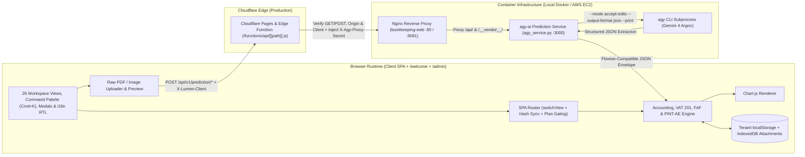
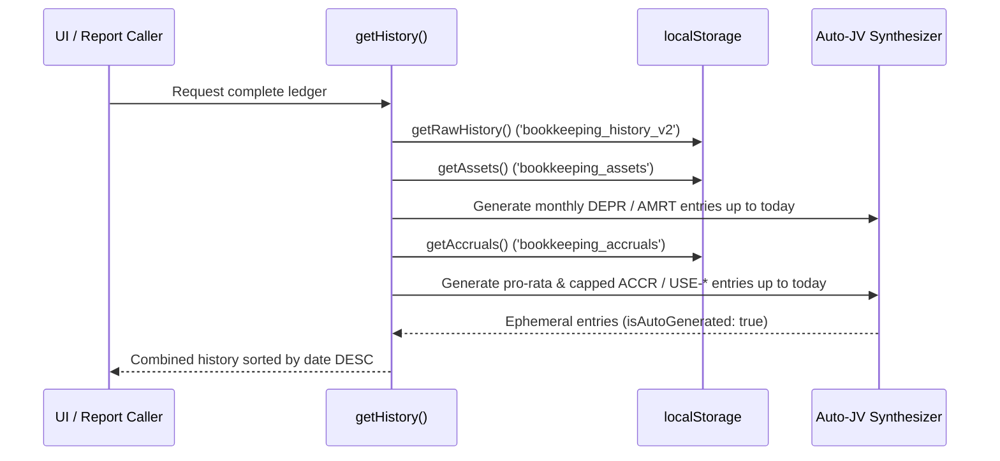

# Technical Architecture & Execution Flow

## 1. High-Level Architecture

Lumen Accounting Suite is a browser-hosted multi-module Single-Page Application (SPA) and multi-tenant commercial workspace built with vanilla HTML5, CSS3 (`style.css`, `components.css`, `profiles.css`, `theme-pro.css`, `fx-correction.css`, `expenses.css`, `i18n.css`, `welcome.css`, `admin.css`, `ui-kit.css` — unified under the Enterprise Finance Navy `#0c1a2e` & Royal Sapphire `#1d4ed8` design token system), and ES6+ JavaScript across 3 HTML entrypoints (`index.html`, `welcome.html`, `admin.html`), 7 synchronous view-template modules (`views-transactions.js`, `views-operations.js`, `views-workforce-and-quotes.js`, `views-sales-and-banking.js`, `views-accounting-and-tax.js`, `views-reports-and-settings.js`, `views-modals.js`), 15 modular application controller scripts (`app-core-and-router.js` through `app-quotes-pos-recurring.js` plus `script.js`), 4 shared UI-kit modules (`ui-feedback.js` — design-system toasts plus confirm/prompt `alertdialog`s that replace all native browser dialogs and load before every feature module; `ui-forms.js` — inline, accessible constraint validation for every `<form>`; `ui-tables.js` — `tbody[data-paginate]` pagination, search and new-row highlighting; `ui-layout.js` — the off-canvas navigation drawer below 960 px), and 24 specialized domain modules (`profiles-storage.js`, `profiles-ui.js`, `auth.js`, `welcome-plans.js`, `welcome.js`, `admin.js`, `plan-access.js`, `plan-gating.js`, `i18n.js`, `attachments-store.js`, `ar-posting-fix.js`, `fx-correction.js`, `po-preview.js`, `po-receiving.js`, `quote-preview.js`, `einvoice-ae.js`, `credit-notes.js`, `vat201.js`, `faf-export.js`, `expenses.js`, `corp-tax-tracker.js`, `compliance-reminders.js`, `wps-gratuity.js`, `whatsapp-workflows.js`). Locally, it is served via an Nginx reverse proxy (`bookkeeping-web` on port `9091`) configured in `default.conf` with clean URL routes (`/welcome`, `/admin`), `/__vendor__/` offline asset shims (`pdf.min.js`), and `/api/` reverse-proxy forwarding (`client_max_body_size 50M`, `proxy_read_timeout 300s`) to the containerized `agy-ai` prediction service (`bookkeeping-agy-ai` on port `3000`, running `agy_service.py`). In production, the static suite and its edge proxy (`functions/api/[[path]].js`) are deployed on **Cloudflare Pages** (`https://lumen-bookkeeping.pages.dev` and `https://bookeeping.lumenconsultancy.net`), which enforces HTTP method allowlisting (`GET`/`POST`), validates the request `Origin` and `X-Lumen-Client: lumen-bookkeeping-web` header at the Cloudflare edge, fails closed (`503`) if `AGY_BACKEND_URL` is absent, injects the shared secret `X-Agy-Proxy-Secret`, and forwards `/api/v1/prediction/*` requests to the **AWS EC2** `agy-ai` stack (`i-09003c32e39617fea` in `us-east-1`, `docker-compose.prod.yml`). Transactional, master-data, and configuration state is persisted synchronously in tenant-scoped browser `localStorage` (`LumenProfiles`), while binary document attachments (`fileBase64`) are offloaded asynchronously to **IndexedDB** (`attachments-store.js` / `lumen_attachments_v1`). At read time, the ledger engine dynamically merges persisted transactions (`bookkeeping_history_v2`) with deterministically synthesized depreciation, amortization, and deferred-revenue recognition journal vouchers derived from active Fixed Assets and Accrual/Deferred Revenue schedules.



---

## 2. Phase-by-Phase Technical Breakdown

### Phase 1: Multi-Tenant Auth, Chart of Accounts Initialization & SPA Routing

When the browser loads `welcome.html`, `admin.html`, or `index.html`, the suite initializes multi-tenant storage isolation (`profiles-storage.js`), PBKDF2-SHA256 authentication (`auth.js`), bilingual `EN`/`AR` RTL dictionary translation (`i18n.js`), subscription plan gating (`plan-access.js`, `plan-gating.js`), synchronous view/modal DOM template mounting (`views-*.js`), and the 26-view workspace router (`app-core-and-router.js` / `script.js`):

1. **Multi-Tenant Storage Isolation & RBAC (`profiles-storage.js`, `auth.js`, `plan-access.js`, `plan-gating.js`)**:
   - `profiles-storage.js` wraps `Storage.prototype.getItem`, `setItem`, and `removeItem` so all non-global `bookkeeping_*` keys are transparently prefixed with `profile:<activeProfileId>::<key>`.
   - Unauthenticated sessions resolve to the `'unauthenticated'` storage namespace and are redirected from `index.html` to `/welcome`. Non-owner accounts (`id !== 'owner'`) only see their own company profiles (`tenant-${accId}` fallback) and cannot invoke owner-only administrative APIs (`setPlan`, `listAllAccounts`, `updateAccountAdmin`, `approvePlanRequest`, `impersonateAccount`).
   - `plan-access.js` and `plan-gating.js` map canonical subscription tiers (`basic`, `advance`, `premium`, plus legacy aliases `free`/`trial` $\rightarrow$ `basic`, `pro` $\rightarrow$ `advance`, `enterprise` $\rightarrow$ `premium`) to screen locks and company-profile limits (`{ basic: 1, advance: 3, premium: Infinity }`).

2. **Chart of Accounts (COA) Initialization**:
   - A default `CHART_OF_ACCOUNTS` array of 37 standard accounts across 5 types (`Asset`, `Liability`, `Equity`, `Revenue`, `Expense`) is defined in memory (`1000 Cash` through `7000 Depreciation Expense`, including `2150 Deferred Revenue / Customer Advances` for IFRS 15 unearned customer advances).
   - **Persistence Override & Fallback Branching**:
     - If `localStorage.getItem('bookkeeping_coa')` exists, `CHART_OF_ACCOUNTS` is replaced completely by the parsed JSON array (with `app-core-and-router.js` ensuring `2150 Deferred Revenue / Customer Advances` is present).
     - Otherwise, if `localStorage.getItem('bookkeeping_custom_accounts')` contains entries, those custom accounts are concatenated onto the default array.
   - **Expense Account Predicate (`window.isExpenseAccount`)**:
     - Returns `false` immediately if `accString` is falsy; otherwise lowercases `accString`, matches by `code` or `name.toLowerCase()`, and returns `acc.type === 'Expense'`.
   - **Datalist Population**:
     - `#allCoaList` is populated with `<option value="${acc.code} ${acc.name}">` for every account.
     - `#supplierCoaList` is filtered to accounts where `acc.type === 'Expense'` or `acc.code` is in `['1300', '1400', '1410', '1420', '1600']` (Inventory, Prepaid Expenses, and Property, Plant & Equipment).

3. **SPA View Router (`switchView(targetId, title)`), Collapsible Navigation, Command Palette (`Ctrl+K` / `Cmd+K`) & URL Hash Synchronization**:
   - Validates that `#${targetId}` is a valid `.app-view` element and checks `window.LumenPlanGate.canOpen(targetId)` so locked subscription views (decorated with inline `<svg class="lock-icon">` badges inside `.lock-badge`) cannot be bypassed via URL hash or direct `switchView` calls.
   - Hides all `.app-view` elements (`style.display = 'none'`), displays `#${targetId}` (`style.display = 'block'`), updates `.nav-item.active` state, normalizes `#pageTitle.textContent`, and updates `window.history.replaceState(null, '', '#' + targetId)` (with inbound `hashchange` and initial `#view-*` load support).
   - Populates a 2-letter monogram (`item.dataset.abbr` rendered via `.nav-dropdown-content .nav-item::before { content: attr(data-abbr); }`) and `title` tooltip on all sub-navigation items so collapsing the sidebar (`#btnSidebarToggle` / `body.sidebar-collapsed`) preserves full 26-view navigation alongside the keyboard-accessible Quick-Jump Command Palette (`#btnQuickJump` / `Ctrl+K` / `Cmd+K`) and `Escape` modal dismissal.
   - Triggers view-specific rendering hooks across all 26 views (`view-audit`, `view-equity-statement`, `view-accrual`, `view-quotes`, `view-po`, `view-recurring`, etc.).

4. **Startup Migrations & Background Timers**:
   - `loadCompanySettings()`, `rebuildInventoryFromHistory()`, `updateKPIs()`, `loadCustomerDirectory()`, and `loadSupplierDirectory()` execute on startup; Quote/PO tables initialize at `t + 500ms`; recurring templates (`renderRecurringTemplates()` & `executeRecurringTransactions()`) run at `t + 1000ms`.

---

### Phase 2: State Persistence, Audit Trail & Dynamic Auto-JV Synthesis



1. **Raw vs. Synthesized Ledger State (`getRawHistory`, `getHistory`, `updateHistory`)**:
   - `getRawHistory()` reads persisted entries from `bookkeeping_history_v2`.
   - `getHistory()` begins with `getRawHistory()` and dynamically appends ephemeral journal entries (`isAutoGenerated: true`) for:
     - **Fixed Assets & Prepaid Assets (`bookkeeping_assets`)**:
       - Computes `maxMonths = parseInt(asset.years) * 12` and `monthlyDepreciation = parseFloat(asset.initialValue) / maxMonths`.
       - Starting from the last day of the purchase month, loops while `currentMonth <= today && monthsPassed < maxMonths`.
       - **Account Mapping Branches (`resolvePrepaidExpenseAccount`)**:
         - Default fixed asset: Debit `7000 Depreciation Expense`, Credit `1650 Accumulated Depreciation`, prefix `DEPR`.
         - Prepaid Expense Routing (`resolvePrepaidExpenseAccount(accountStr, itemCategory, itemsList)`):
           - If `itemCategory` or any item in `itemsList` has `category === 'COGS'`, or if `accountStr` matches `5000` / `cogs` / `cost of goods`, routes the amortization debit to `5000 Cost of Goods Sold`.
           - If `asset.account` matches `1410` or `prepaid rent`: Debit `6400 Rent Expense`, Credit `1410 Prepaid Rent`, prefix `AMRT`.
           - If `asset.account` matches `1420` or `prepaid software`: Debit `6200 Software & SaaS`, Credit `1420 Prepaid Software & SaaS`, prefix `AMRT`.
           - If `asset.account` matches `1400` or `prepaid`: Debit `6000 Office Supplies`, Credit `1400 Prepaid Expenses`, prefix `AMRT`.
     - **Accruals, Prepayments & Deferred Revenue (`bookkeeping_accruals`)**:
       - Supports both **straight-line monthly schedules** (`scheduleMode !== 'usage'`) and **usage/milestone-based schedules** (`scheduleMode === 'usage'` or `Array.isArray(accrual.usageEntries) && accrual.usageEntries.length > 0`, e.g., `2150 Deferred Revenue / Customer Advances` customer advances and prepaid supplier credits routed to `5000 Cost of Goods Sold` or `6xxx` OpEx).
       - For usage-based schedules, iterates over `accrual.usageEntries` (`[{ id, date, amount, note }]`), caps each drawdown to `totalAmount - usedSoFar`, and emits a synthesized `journal` entry with ID `u.id || usage_${accrual.id}_${idx + 1}` and entity name `USE-${accrual.id.substring(0, 4).toUpperCase()}-${idx + 1}`.
       - For straight-line schedules, loops month-by-month from the end of `startDate`'s month with first-month pro-rata calculation ($\text{jvAmount} = \text{monthlyAmt} \times \frac{\text{daysActive}}{\text{totalDaysInMonth}}$) and cap enforcement (`totalAmount - accumulated`), emitting `ACCR-${id.slice(0,4)}-${monthIndex+1}`.
   - `updateHistory(history)` filters out synthesized entries (`!h.isAutoGenerated`) and offloads inline `fileBase64` payloads to IndexedDB via `window.LumenAttachments` (`attachments-store.js`).

2. **Period Locking (`isLocked(dateStr)`) & Audit Logging (`logAuditEvent(action, module, details)`)**:
   - `isLocked(dateStr)` compares against `bookkeeping_closed_date` and prevents mutating or deleting closed-period entries.
   - `logAuditEvent` prepends `{ id, timestamp, user: 'Admin User', action, module, details }` to `bookkeeping_audit_log`.

---

### Phase 3: AI Document Processing Pipeline

1. **Raw PDF & Image Upload + Client Preview (`fileToDataURL(file)` & `convertPdfToImage(file)`)**:
   - Across all 5 AI extraction workflows, the raw binary file is encoded as a Base64 Data URL (`application/pdf` or `image/*`) via `fileToDataURL(file)` and sent directly in the `uploads` array so `agy-ai` receives the lossless original PDF document.
   - `convertPdfToImage(file)` renders PDF pages onto an HTML5 `<canvas>` via `pdfjsLib.getDocument` for browser-side preview.

2. **Resilient JSON Extraction (`extractJSON` / `custExtractJSON`) & Foreign Currency Repair (`fx-correction.js`)**:
   - Extracts fenced ```` ```json ... ``` ```` blocks or JSON object/array boundaries, and normalizes foreign-currency invoices (`USD`, `EUR`, `GBP`, `SAR`, etc.) into AED via `LumenFxCorrection`.

3. **Five AI Extraction Workflows (`app-*.js` & `expenses.js` $\rightarrow$ Cloudflare Pages Function / Nginx $\rightarrow$ `agy_service.py` $\rightarrow$ `agy` CLI)**:
   - **Multi-Layer Prediction Endpoint Security (`_verify_prediction_request_security`)**:
     1. **Shared Proxy Secret (`X-Agy-Proxy-Secret`)**: Verified via `hmac.compare_digest` against `AGY_API_SECRET` (`HTTP 401` on mismatch).
     2. **Application Client Handshake (`X-Lumen-Client`)**: Verifies `X-Lumen-Client == "lumen-bookkeeping-web"` across `#processBtn`, `#custProcessBtn`, `#btnProcessJournalFile`, `#processBankBtn`, and `#expAnalyzeBtn` (`HTTP 401` if absent).
     3. **Origin & Referer Allowlist (`_is_allowed_origin`)**: Validates trusted origins (`HTTP 403` on untrusted origins).
   - **Backend `agy` Prediction Execution (`agy_service.py`)**:
     - Validates `Content-Length` ($\le 50\text{ MB}$), writes Base64 uploads to `/tmp/agy_requests/req_<uuid>/` with `is_relative_to` path-traversal protection, executes `agy --mode accept-edits --dangerously-skip-permissions --disable-slash-commands --output-format json --model "Gemini 4 Argon (High)" --print-timeout 99999h --add-dir <req_dir> --print <prompt>`, and returns `{"text": response, "conversation_id": conv_id, "status": status}`.
   - **Workflows**: Supplier Invoice (`#processBtn`), Customer Invoice (`#custProcessBtn`), Direct Expense Receipt (`#expAnalyzeBtn`), Petty Cash Multi-Receipt (`#btnProcessJournalFile`), and Bank Statement & Rules Engine (`#processBankBtn`).

---

### Phase 4: Commercial, Credit Notes, WhatsApp Workflows, Contacts & Inventory Subsystems

1. **Customer & Supplier Directories**: Upsert contact records (`saveCustomer`, `saveSupplier`) and enforce referential integrity in `deleteCustomer(name)`.
2. **Executive Tax Invoice Preview, A4 Print Isolation & Tax Credit Notes (`credit-notes.js` — UAE FTA VAT Art. 59 & Art. 60)**:
   - `renderTaxDocumentPreview` renders single-language (`en` or `ar`) Tax Invoices and Tax Credit Notes with a `dir="ltr"` header block (`flex-wrap: nowrap`, top-left company logo, top-right company details constrained to `max-width: 58%`), centered `.ei-title-banner` (`TAX INVOICE` / `فاتورة ضريبية`), left `Billed To:` card, right 4-field executive metadata card (`Invoice No.`, `Invoice Date`, `Terms`, `Due Date`), `table-layout: fixed` item table, `Dirhams Only.` amount in words, and a computer-generated document footer note.
   - `printTaxDocument` isolates `#invoiceModal` on A4 portrait (`body.printing-invoice-modal` with `@media print` and `print-color-adjust: exact`).
   - Issues sequential `CRN-####` credit notes linked to an original Tax Invoice, validates creditable balance, and reverses `4xxx` Revenue, `2500 Output VAT`, and `1200 Accounts Receivable` across GL, Trial Balance, KPIs, VAT 201, and FAF.
3. **WhatsApp-First Sharing & Camera Receipt 15-Digit TRN OCR (`whatsapp-workflows.js`, `expenses.js`)**:
   - `UAEWhatsAppWorkflows` normalizes UAE phone numbers to E.164 `9715XXXXXXXX` (`normalizeUaePhone`), builds single-language (`en` or `ar`) WhatsApp invoice messages and `https://wa.me/<phone>?text=...` URLs (`buildInvoiceMessage`, `buildWhatsAppShareUrl`, `shareDocumentViaWhatsApp`) with embedded payment links (`paymentLink` / `companyPaymentLink`), validates 15-digit UAE TRNs starting with `100` (`isValidUaeTrn`), and extracts 15-digit Vendor TRNs, Emirate place of supply, and 5% VAT from camera receipt OCR payloads (`extractReceiptTrnAndVat`, `#expCameraInput`, `#expSnapCameraBtn`, `#expVendorTrn`).
4. **Inventory Directory & Stock Ledger**: Bidirectional Cost/Markup/Price math, `window.logStockMovement` (`bookkeeping_stock_ledger` + `bookkeeping_inventory`), automatic COGS & stock `OUT` on customer invoice save, and stock reversal on entry deletion.
5. **Quotes, Purchase Orders & Recurring Templates (`quote-preview.js`, `po-preview.js`, `po-receiving.js`, `ar-posting-fix.js`)**: Quotes (`Draft` $\rightarrow$ `Invoiced`), POs (`Draft` $\rightarrow$ `Goods Received` $\rightarrow$ `Billed` with 3-way matching), and Recurring Templates (`bookkeeping_recurring_v2`).

---

### Phase 5: Payroll, Timesheets, UAE WPS & Art. 51 EOSB Engine

1. **Net Pay Formula (`calcNetPay(empId)`)**: $\text{earnedPay} = \frac{\text{totalPay}}{30} \times \text{daysWorked}$, $\text{netPay} = \text{earnedPay} + \text{bonus} - \text{loanDed} - \text{otherDed}$.
2. **Payroll Run & Multi-Journal Posting (`savePayroll()`)**: Persists `payroll_${period}` and posts up to 5 double-entry journal vouchers dated `${period}-28` (Gross Payroll `6500`/`2100`, Net Disbursement `2100`/bank, Loan Recovery `2100`/`1210`, Other Deductions `2100`/`6500`, and UAE Labour Law EOSB & Leave Accrual `6520`/`2120`).
3. **Tenure-Aware Statutory Gratuity & MOHRE/CBUAE WPS `.SIF` Engine (`wps-gratuity.js` / `UAEWpsAndGratuity`)**:
   - **UAE Federal Decree-Law No. 33 of 2021 Article 51 Gratuity (`calculateEmployeeGratuity`)**: Excludes `unpaidLeaveDays` from continuous service tenure per Art. 51(4) ($\text{effectiveServiceDays} = \max(0, \text{calendarDays} - \text{unpaidLeaveDays})$, $\text{serviceYears} = \frac{\text{effectiveServiceDays}}{365}$). Applies `0` statutory termination entitlement for `< 1 year` (`under_1_year`, while computing a `21 days/yr` monthly accounting accrual), `21 calendar days' basic salary per year` for `1–5 years` (`years_1_to_5`), and `21 days/yr` for the first 5 years plus `30 days/yr` for service exceeding 5 years (`over_5_years`), capped at 2 years' total wage ($24 \times \text{totalPay}$) per Art. 51(2).
   - **MOHRE / CBUAE WPS `.SIF` Export (`buildWpsSif` / `generateWPS()`)**: Emits 10-field `EDR` employee rows (`EDR,<14-digit zero-padded Labour Card>,<9-digit routing code>,<sanitized IBAN>,<payStartDate>,<payEndDate>,<daysWorked>,<fixedIncome>,<variableIncome>,<leaveDays>`) followed by a 10-field `SCR` control record (`SCR,<13-digit Employer ID>,<9-digit bank routing code>,<YYYY-MM-DD>,<HHMM>,<MMYYYY>,<edrCount>,<totalSalary>,AED,<employerRef>`).

---

### Phase 6: Double-Entry Financial Reporting, KPIs, FP&A & UAE Tax / Regulatory Compliance

1. **Dashboard KPI, Corporate Tax Tracker & UAE Compliance Reminder Engines (`updateKPIs()`, `corp-tax-tracker.js`, `compliance-reminders.js`)**:
   - Computes P&L-scoped vs. cumulative Balance-Sheet metrics, deducts `credit_note` entries from Net Revenue, computes Avg. Monthly Burn, Cash Runway, and Net Profit Margin, and populates `#criticalArList` / `#criticalApList`.
   - **Live UAE 9% Corporate Tax & Small Business Relief Tracker (`CorporateTaxTracker` / `UAECorpTaxTracker`)**: Computes `netProfit`, `ctAddBacks`, `taxableIncome`, AED `375,000` `0%` threshold usage (`thresholdPct`, `zeroBracketRemaining`), `9%` tax above threshold (`ctPayable`), Ministerial Decision No. 73 of 2023 (Art. 21) AED `3,000,000` Small Business Relief eligibility (`sbrEligibleByRevenue`, `sbrElectiveActive`, `sbrDisqualifiedExceededCap`), and `Qualifying Free Zone` (`0%` QFZP) regime status, rendering live progress bars and badges into `#corpTaxTrackerCard` on ledger, supplier bill, and trial balance updates.
   - **UAE Compliance & Renewal Reminders (`UAEComplianceReminders`)**: Evaluates Trade License (`tradeLicenseNumber`, `tradeLicenseExpiry`), Establishment Card (`establishmentCardNumber`, `establishmentCardExpiry`), Employee Residence Visa (`visaExpiry`), and Emirates ID (`emiratesIdExpiry`) dates against `URGENT_THRESHOLD_DAYS = 30` and `WARNING_THRESHOLD_DAYS = 60`, rendering XSS-escaped status badges and alerts into `#uaeComplianceReminderCard`.
2. **Trial Balance, Emirate-Level FTA VAT 201 (`vat201.js`), FTA Audit File (`faf-export.js`) & UAE Corporate Tax**:
   - **VAT 201 (`vat201.js`)**: Classifies standard-rated (`5%`) supplies across Emirate Boxes `1a`–`1g` (`Abu Dhabi`, `Dubai`, `Sharjah`, `Ajman`, `Umm Al Quwain`, `Ras Al Khaimah`, `Fujairah`), Reverse Charge Boxes `3` & `10`, Zero-Rated Box `4`, Exempt Box `5`, Output VAT Box `8`, Input VAT Boxes `9`–`11`, and Net VAT Payable/Refundable Boxes `12`–`14`.
   - **FTA Audit File (`faf-export.js`)**: Generates the 5-section UAE FTA Audit File (`CompInfo`, `MasterData`, `PurcData`, `SuppData`, `GLData`) with balanced double-entry ledger lines.
   - **UAE Corporate Tax**: Applies the `0%` bracket up to `375,000 AED` and `9%` above `375,000 AED` after adding back non-deductible expenses (`isCtAddBack: true`), with Qualifying Free Zone and Small Business Relief exemptions.
3. **Financial Statements & FP&A**: `renderIncomeStatement()`, `renderBalanceSheet()`, `renderCashflow()`, `renderEquityStatement()`, `renderBudgeting()`, and `renderCashflowForecast()`.

---

## 3. Payload & State Schemas

### 3.1 `localStorage` Keys & Runtime Schemas

```json
{
  "bookkeeping_history_v2": [
    {
      "id": "1730538000000abc12",
      "date": "2026-11-02",
      "dueDate": "2026-11-17",
      "type": "customer",
      "status": "posted",
      "invoiceNum": "INV-1001",
      "entityName": "Acme Corp LLC",
      "account": "4100 Service Revenue",
      "bankAccount": "1005",
      "emirate": "Dubai",
      "vatTreatment": "standard",
      "items": [{ "description": "Consulting Services", "qty": 2, "rate": "2500.00", "amount": "5000.00", "vatRate": 5, "tax": "250.00" }],
      "subtotal": "5000.00",
      "discount": "0.00",
      "tax": "250.00",
      "total": "5250.00",
      "amountPaid": "2000.00",
      "isCtAddBack": false
    }
  ],
  "bookkeeping_assets": [
    {
      "id": "1730538100000def34",
      "description": "MacBook Pro M3 Max",
      "location": "Dubai HQ",
      "purchaseDate": "2026-01-15",
      "initialValue": "12000.00",
      "years": "3",
      "account": "1600 Property, Plant & Equipment"
    }
  ],
  "bookkeeping_accruals": [
    {
      "id": "1730538200000ghi56",
      "startDate": "2026-01-01",
      "description": "Annual Cloud Infrastructure Credit",
      "drAcc": "5000 Cost of Goods Sold",
      "crAcc": "1420 Prepaid Software & SaaS",
      "totalAmount": "120000.00",
      "lifeMonths": "12",
      "monthlyAmortization": "10000.00",
      "scheduleMode": "usage",
      "usageEntries": [{ "id": "usage_1730538200000ghi56_1", "date": "2026-02-15", "amount": 15000.00, "note": "February GPU cluster consumption" }]
    }
  ],
  "bookkeeping_settings": {
    "companyName": "Lumen Books LLC",
    "companyAddress": "DIFC, Dubai, UAE",
    "companyTrn": "100234567890003",
    "companyBankAccount": "1005",
    "companyPaymentLink": "https://pay.ziina.com/lumen/default",
    "flowiseEndpoint": "/api/v1/prediction/937be8b1-663e-45a5-a9d7-b5c912ac1abd",
    "companyType": "Mainland",
    "smallBusinessRelief": false,
    "tradeLicenseNumber": "DED-88441",
    "tradeLicenseExpiry": "2027-08-15",
    "establishmentCardNumber": "EST-99110",
    "establishmentCardExpiry": "2027-09-01",
    "wpsEmployerId": "1002233445566",
    "wpsBankRoutingCode": "302620122",
    "wpsEmployerRef": "WPS-LUMEN-202610"
  }
}
```

### 3.2 UAE Peppol PINT-AE UBL 2.1 XML E-Invoice Schema (`einvoice-ae.js` / `EInvoiceAE.buildXml`)

```xml
<?xml version="1.0" encoding="UTF-8"?>
<Invoice xmlns="urn:oasis:names:specification:ubl:schema:xsd:Invoice-2"
         xmlns:cac="urn:oasis:names:specification:ubl:schema:xsd:CommonAggregateComponents-2"
         xmlns:cbc="urn:oasis:names:specification:ubl:schema:xsd:CommonBasicComponents-2">
    <cbc:CustomizationID>urn:peppol:pint:billing-1@ae-1</cbc:CustomizationID>
    <cbc:ProfileID>urn:peppol:bis:billing</cbc:ProfileID>
    <cbc:ID>INV-1001</cbc:ID>
    <cbc:IssueDate>2026-11-02</cbc:IssueDate>
    <cbc:DueDate>2026-11-17</cbc:DueDate>
    <cbc:InvoiceTypeCode>380</cbc:InvoiceTypeCode>
    <cbc:DocumentCurrencyCode>AED</cbc:DocumentCurrencyCode>
    <cbc:TaxCurrencyCode>AED</cbc:TaxCurrencyCode>
</Invoice>
```

### 3.3 UAE WPS `.sif` (`EDR` / `SCR`) & `agy-ai` Prediction Envelope (`agy_service.py`)

```text
EDR,78419901234567,302620122,AE070331234567890123456,2026-10-01,2026-10-31,30,20000.00,1500.00,0
SCR,1002233445566,302620122,2026-10-28,1430,102026,1,21500.00,AED,WPS-LUMEN-202610
```

```json
{
  "request": {
    "question": "You are an expert AI accountant processing a SUPPLIER INVOICE...",
    "uploads": [{ "data": "data:application/pdf;base64,JVBERi0xLjQK...", "type": "file", "name": "supplier_invoice.pdf", "mime": "application/pdf" }]
  },
  "response_200": {
    "text": "```json\n{\"date\":\"2026-10-15\",\"invoiceNum\":\"SUP-AI-8001\",\"entityName\":\"Gulf Cloud Infrastructure LLC\",\"subtotal\":2000,\"discount\":0,\"tax\":100,\"total\":2100,\"currency\":\"AED\"}\n```",
    "conversation_id": "b9c90af2-4bf8-494e-ac9e-59571dbb06b7",
    "status": "SUCCESS"
  },
  "error_envelope": {
    "error": { "code": "unauthorized", "message": "Unauthorized: prediction endpoint is restricted to the Lumen Bookkeeping application." },
    "text": "```json\n{}\n```"
  }
}
```
